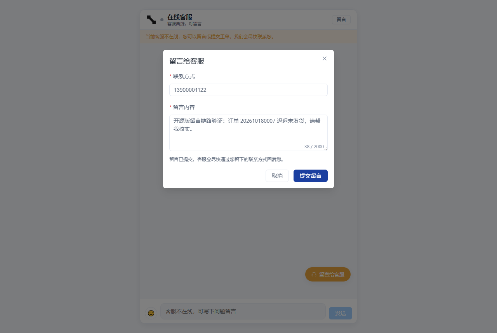
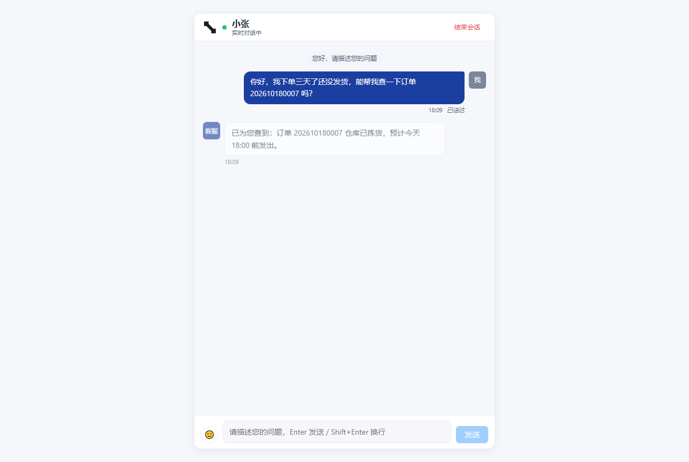
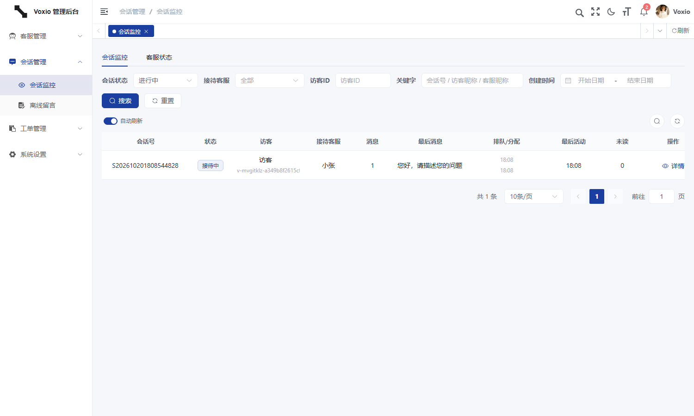
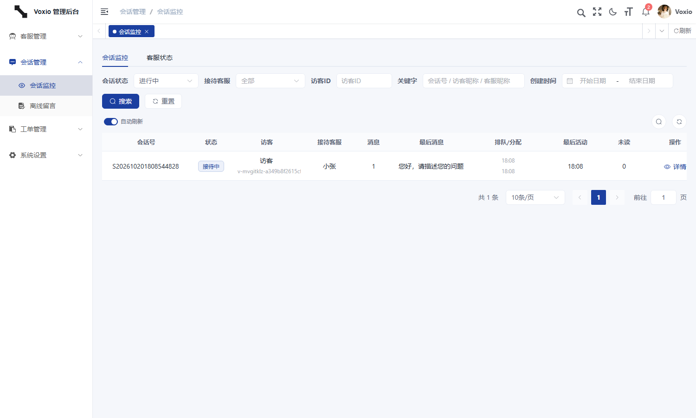
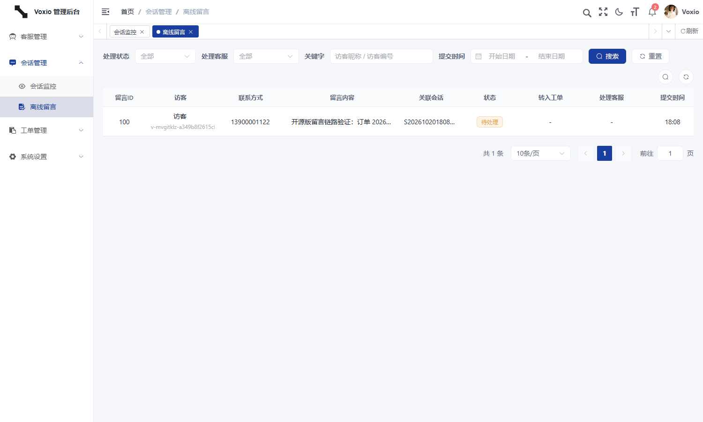
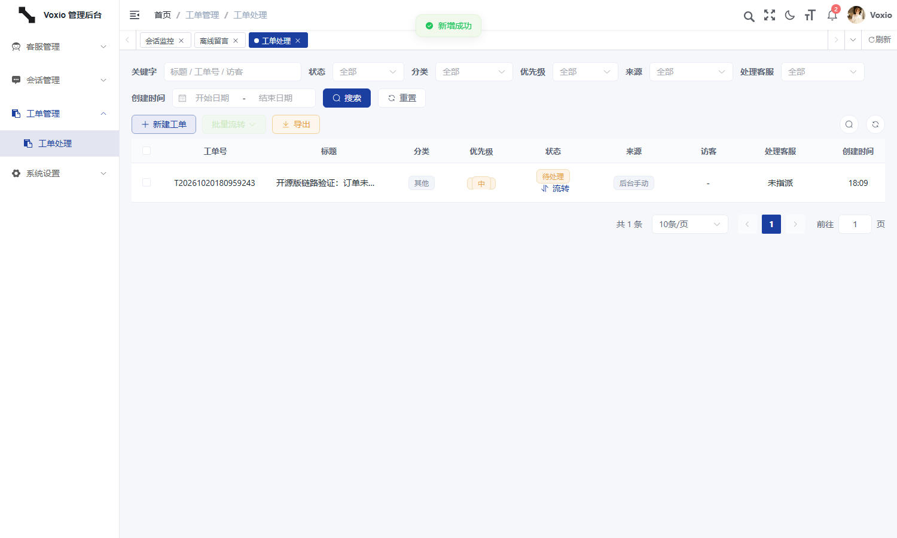

<p align="center">
  
</p>

<h1 align="center">Voxio 开源版</h1>

<p align="center">
  基于 Netty + Spring Boot + Vue3 的轻量级在线客服系统
</p>

<p align="center">
  <a href="https://gitee.com/wusiwee/voxio-public"></a>
  <a href="https://github.com/wusiwee/voxio-public/stargazers"></a>
  <a href="https://github.com/wusiwee/voxio-public/network/members"></a>
  
  
  
  
  
</p>

<p align="center">
  产品官网、完整功能与最新版本说明：<b><a href="https://voxio.sinbyte.com.cn">https://voxio.sinbyte.com.cn</a></b>
</p>

<p align="center">
  
  <br/>
  <sub>扫码咨询商业版 / 部署支持（工作微信 <b>18100174199</b>，服务时间 7:00 ~ 23:00，添加请备注「在线客服咨询」）</sub>
</p>

---

## 目录

- [项目简介](#项目简介)
- [功能特性](#功能特性)
- [快速开始](#快速开始)
- [技术栈](#技术栈)
- [项目结构](#项目结构)
- [开源版 vs 商业版](#开源版-vs-商业版)
- [贡献指南](#贡献指南)
- [许可证](#许可证)
- [联系与支持](#联系与支持)
- [附：技术细节](#附技术细节)（架构与端口 · 协议 · 数据模型 · 自建客服端 · 国密 · 界面预览 · 部署 · 二次开发）

---

## 项目简介

Voxio 是一套**单商户自部署**的在线客服系统：访客在自己的网站里发起咨询，客服在工作台接待，管理员在后台处理工单与留言。
一个 Spring Boot 后端 + 一个 Netty 聊天网关 + 两个 Web 前端，全部组件可以跑在你自己的一台服务器上，
会话、消息、附件与工单都落在你自己的库里，不经过任何第三方云。

它解决的是「中小企业想自己扛一套客服系统，但不想被 SaaS 绑定、也不想上一堆微服务」这件事：
刻意不做多租户、不做商户入驻与套餐计费、不做平台总控、不上容器编排与分库分表，因此整套代码可以在几天内读懂、可以直接拿去二开。

**版本边界（先说清楚，省得互相浪费时间）**

> 开源版包含**基础聊天、排队分配、离线留言、基础工单流转、管理后台与审计留痕**；
> 商业版包含**完整客服工作台（Windows 桌面端）、会话转接、FAQ、快捷回复、满意度评价、统计报表、国密加密交付口径**；
> AI 客服版在此之上再加**本地大模型 + 企业知识库（RAG）+ 意图识别与防幻觉拒答 + AI 自动建单**。
> 开源版**不含 AI 能力**，也不会往这个仓库里放模型与知识库代码。

## 功能特性

- **Netty WebSocket 基础聊天**：独立网关，WS（浏览器）与 TCP（原生客户端）双通道共用一套 JSON 信封；已读回执、typing 提示、断线重连与按 `seq` 增量补发
- **排队与分配**：无空闲客服时进队列并实时播报排位；`kf.assign.enabled` 控制自动分配，策略「空闲优先」，主管可在后台人工指派
- **会话超时**：定时任务按 `kf.session.timeout.minutes` 自动结束无活动会话，并留下 `end_by=3` 的系统结束口径
- **离线留言**：无客服在线时访客留下问题与联系方式，后台处理后可一键转为工单
- **基础工单流转**：建单、状态流转（待处理 → 处理中 → 已解决 / 已关闭）、回复与流转留痕、Excel 导出
- **会话监控**：实时查看进行中的会话、消息与客服负载，支持人工分配
- **Spring Boot 管理后台**：若依 RBAC（用户/角色/菜单）+ 独立的客服账号体系（`kf_agent`），两套令牌互不通用
- **Vue3 用户端**：访客端打开即对话框，FAQ 前置、窄屏适配，可嵌入第三方站点子路径
- **安全留痕**：客服登录日志、业务审计日志（只读、防删、可配留存期）、登录失败锁定、口令复杂度策略
- **可选国密**：SM2 / SM3 / SM4-GCM 实现完整内置，默认关闭，一行配置开启

## 快速开始

### 环境要求

JDK **17+**（Spring Boot 3.5 的最低要求，**不是 JDK 8**）· Maven 3.6+ · Node 18+ · MySQL 8+ · Redis 5+ · nginx 1.20+（生产入口）

### 1. 初始化数据库

```bash
mysql -u root -p --default-character-set=utf8mb4 \
      -e "create database if not exists \`voxio-public\` default charset utf8mb4 collate utf8mb4_general_ci"

mysql -u root -p --default-character-set=utf8mb4 voxio-public < voxio-server/sql/voxio_chat.sql
```

建库脚本只有一份：**`voxio-server/sql/voxio_chat.sql`**（含建表、字典、菜单、参数与初始化账号）。
脚本可重复执行（表 `drop if exists`、菜单字典先删后插、参数幂等 upsert、加列加索引走 `information_schema` 守卫），升级即重跑。
**必须带 `--default-character-set=utf8mb4`**，否则中文与表情会存成 `???`。

### 2. 构建

```bash
cd voxio-server          && mvn -DskipTests clean package     # → voxio-admin/target/voxio-admin.jar
cd ../voxio-ui           && npm install && npm run build:prod # → dist/（base=/admin/）
cd ../voxio-cs-user-ui   && npm install && npm run build      # → dist/（站点根路径）
```

### 3. 启动

```bash
# 后端（同一 JVM 内一并拉起 Netty 网关）
java -jar voxio-server/voxio-admin/target/voxio-admin.jar

# 两个前端（开发模式）
cd voxio-ui         && npm run dev   # http://localhost/admin/
cd voxio-cs-user-ui && npm run dev   # http://localhost:5173
```

| 入口 | 地址 | 默认账号 |
| --- | --- | --- |
| 管理后台 | http://localhost/admin/ | `admin` / `admin123` |
| 访客网页端 | http://localhost:5173 | 无需账号，自动签发访客号 |
| 后端 HTTP | http://localhost:10096/customer | — |
| 聊天网关 | ws://localhost:10097/ws · tcp://127.0.0.1:10098 | 客服令牌鉴权 |

### 4. 默认账号与出厂值

| 项 | 值 |
| --- | --- |
| 管理员 | `admin` / `admin123` |
| 客服 | `kefu01` / `kefu02` / `kefu03`，口令 `admin123`（`kefu03` 出厂停用） |
| 主管角色 | `role_id = 3`，授予客服业务菜单 |
| MySQL / Redis | `127.0.0.1`，口令 `wusiwee123`，库名 `voxio-public` |

> 以上都是**开发用的出厂默认值**。对外提供服务前，请务必改掉全部默认口令、替换 `token.secret`，并换成自己的国密密钥。

### 5. 配置说明

配置只有三份明文文件，**不使用 `.env` 或外置配置文件**：

| 文件 | 放什么 |
| --- | --- |
| `application.yml` | 两个环境完全一致的内容：端口与上下文、连接池、网关参数、日志级别、加密开关 |
| `application-dev.yml` | 开发环境：本机 MySQL / Redis 地址与口令、上传落盘目录、密钥目录、日志级别 |
| `application-prod.yml` | 生产环境：服务器上的 MySQL / Redis 地址与口令、上传落盘目录、密钥目录、日志级别 |

jar 默认激活 `dev`，部署到服务器时显式切换：`java -jar voxio-admin.jar --spring.profiles.active=prod`。
改配置 = 改对应 profile 文件 → 重新打包 jar，所以「线上跑的是哪套参数」只看 jar 本身。

## 技术栈

| 层 | 选型 |
| --- | --- |
| 后端 | Spring Boot 3.5.16、MyBatis-Plus、Druid、Quartz、Spring Security + JWT |
| 实时链路 | Netty 4.x 独立聊天网关（WebSocket + TCP 双通道，自定义 JSON 信封） |
| 前端 | Vue 3、Vite、Element Plus、Vue Router |
| 数据库 | MySQL 8（单库 `voxio-public`，utf8mb4） |
| 缓存 | Redis（令牌、排队位次、会话与参数缓存） |
| 加密 | BouncyCastle（SM2 / SM3 / SM4-GCM，默认关闭） |
| 部署 | nginx 反向代理 + 静态站点；后端一个 jar |

## 项目结构

```
voxio-public/
├── voxio-server/            Spring Boot 后端 + Netty 网关（Maven 多模块）
│   ├── voxio-admin/         Web 入口与打包模块（application*.yml、logback.xml），产出的 jar 是唯一投递物
│   ├── voxio-chat-netty/    Netty 4.x 聊天网关：编解码、鉴权、限流、连接注册、消息分发、投递与补发
│   ├── voxio-desk/          客服业务域：会话、消息、工单、离线留言、会话监控、业务参数、审计与开放接口
│   ├── voxio-framework/     框架基建：安全过滤链、数据源、缓存、切面、拦截器
│   ├── voxio-system/        系统域（若依）：用户、角色、菜单、部门、岗位、字典、参数、公告、日志
│   ├── voxio-quartz/        定时任务基座；客服域的 Job 在 voxio-desk 里注册
│   ├── voxio-common/        通用工具、域模型基类、国密加解密层
│   └── sql/voxio_chat.sql   唯一建库脚本
├── voxio-ui/                管理后台（Vue3 + Vite + Element Plus，构建产物挂 /admin/）
│   └── brand/               设计 token 与品牌资产来源 + 分发脚本
├── voxio-cs-user-ui/        访客网页端（Vue3 + Vite，站点根路径）
├── doc/
│   ├── images/              界面截图与咨询二维码
│   ├── nginx/voxio.conf     可直接复制到 /etc/nginx/conf.d/ 的站点配置
│   └── 部署文档.docx         生产部署手册（jar + dist + nginx）
└── README.md
```

## 开源版 vs 商业版

| 能力 | 开源版 | 基础版 | AI 客服版 |
| --- | :---: | :---: | :---: |
| Netty 基础聊天、离线留言、基础工单流转 | ✓ | ✓ | ✓ |
| 排队分配、会话监控、审计与登录日志 | ✓ | ✓ | ✓ |
| Windows 客服工作台（桌面端） | × | ✓ | ✓ |
| 多客服会话转接、FAQ、快捷回复、满意度评价 | × | ✓ | ✓ |
| 统计报表与运营总览 | × | ✓ | ✓ |
| 国密加密（等保三级基础能力） | 可选开启 | ✓ | ✓ |
| 本地大模型（Qwen）对话 | × | × | ✓ |
| 企业文档知识库投喂（RAG） | × | × | ✓ |
| 意图识别与防幻觉拒答 | × | × | ✓ |
| AI 自动创建工单 | × | × | ✓ |
| 无人接待时 AI 自动应答（7x24） | × | × | ✓ |

> 需要完整功能？访问官网 **[https://voxio.sinbyte.com.cn](https://voxio.sinbyte.com.cn)** 看版本说明与定价，
> 或扫[顶部二维码](#项目简介)、加工作微信 **18100174199**（服务时间 7:00 ~ 23:00）咨询；
> 价格、授权范围与实施条款以官网定价页与合同为准。

## 贡献指南

**提 Issue**：先写清复现步骤与环境（后端版本、MySQL / Redis 版本、浏览器），再贴日志片段；
涉及聊天链路的问题请一并给出时间点与命令字（`CHAT` / `ACK` / `SYNC`），方便和服务端日志对账。

**提 PR**：

1. Fork 本仓库，从 `main` 切分支（`feat/xxx`、`fix/xxx`）。
2. 保持最小改动：一个 PR 只解决一件事，不顺手重构。
3. 提交前本地跑通：`mvn -DskipTests clean package` + 两个前端 `npm run build`。
4. PR 描述写清「改了什么 / 为什么 / 怎么验证」，界面类改动请附截图。

**开发规范**：

- JDK 17、源码 UTF-8；不引入新框架与中间件，不拆微服务。
- **SQL 只允许出现在 `voxio-server/sql/`**，业务代码不写建表与变更脚本。
- 在线聊天必须走独立 Netty 网关，不允许在 HTTP 线程里自己开长连接；网关只做鉴权、限流、路由与投递，不直接写业务 SQL。
- 访客可见参数一律走 `kf_config` 白名单；密钥类参数（如 `kf.openapi.secret`）不得下发到公开端点，也不得提交 `.env` / 凭据。
- 设计 token 唯一来源是 `voxio-ui/brand/tokens.json`，改完跑 `node voxio-ui/brand/sync-tokens.mjs` 分发。

## 许可证

**本仓库当前尚未提交 `LICENSE` 文件**，因此在补上之前，法律上按「保留所有权利」处理——这是事实说明，不是免责话术。

计划采用 **MIT License**（与所依赖的若依 RuoYi、Element Plus、Netty、BouncyCastle 等上游许可证兼容）。
在 `LICENSE` 落地之前，如果你要在生产环境使用或二次分发，请先在
[Gitee](https://gitee.com/wusiwee/voxio-public) / [GitHub](https://github.com/wusiwee/voxio-public) 提 Issue 确认授权口径，
或直接走商业版（含纸质授权书）。

## 联系与支持

| 渠道 | 地址 |
| --- | --- |
| 产品官网 | **[https://voxio.sinbyte.com.cn](https://voxio.sinbyte.com.cn)** |
| 在线试用（商业版访客端） | [https://service.sinbyte.com.cn](https://service.sinbyte.com.cn) |
| 工作微信 | `18100174199`（服务时间 7:00 ~ 23:00，添加请备注「在线客服咨询」） |
| Gitee | https://gitee.com/wusiwee/voxio-public |
| GitHub | https://github.com/wusiwee/voxio-public |

<p align="center">
  
  <br/>
  <sub>扫码加微信 · 咨询商业版功能、私有化部署与实施支持</sub>
</p>

---

## 附：技术细节

想读懂或改动实现看这一节；只是想跑起来，上面的[快速开始](#快速开始)就够了。

### 架构与端口

```
                 访客（浏览器 / 移动端页面）
                          │  https://your-domain.com/
                          ▼
┌───────────────────────────────────────────────────────────────────────┐
│                              nginx                                    │
│   /            访客端静态站点          /admin/      管理后台静态站点     │
│   /customer/   反向代理 → 10096       /customer-ws  升级转发 → 10097/ws  │
└───────────────┬───────────────────────────────────────┬───────────────┘
                │ HTTP（统一 /customer 前缀）            │ WebSocket
                ▼                                       ▼
┌───────────────────────────────┐    ┌───────────────────────────────┐
│  voxio-admin（Spring Boot）   │◄───│  voxio-chat-netty（Netty 4.x）│
│  会话 / 消息 / 工单 / 留言    │ 服务│  鉴权·心跳·限流·收发·补发     │
│  监控 / 配置 / 审计 / 导出    │ 调用│  同 JVM 启动，不写业务 SQL    │
│  HTTP 10096  上下文 /customer │    │  WS 10097 · TCP 10098         │
└───────────┬───────────────────┘    └───────────────────────────────┘
            │
     ┌──────┴──────┐
     ▼             ▼
┌─────────┐  ┌─────────┐
│ MySQL 8 │  │ Redis   │        客服端：HTTP 接口 + WS 长连接（可自建工作台）
│ 单业务库 │  │ 令牌/缓存│
└─────────┘  └─────────┘
```

| 端口 | 用途 | 是否对公网 |
| --- | --- | --- |
| `80` / `443` | nginx 统一入口：静态站点 + `/customer` 反代 + `/customer-ws` WebSocket | 是（80 跳 443） |
| `10096` | 后端 HTTP，上下文 `/customer` | 否（nginx 反代） |
| `10097` | 聊天网关 WebSocket，握手路径 `/ws` | 否（nginx 反代 `/customer-ws`） |
| `10098` | 聊天网关 TCP（原生客户端长连接） | 否（建议只放行内网） |

**关键设计取舍**

- **聊天链路独立于 HTTP**：消息收发走 Netty 网关的长连接，不占用 Tomcat 线程；网关只做鉴权、限流、路由与投递，
  业务落库通过服务调用回到 `voxio-desk`，不直接写 SQL。
- **`/customer` 前缀贯穿全链路**：它既是 nginx 的代理前缀，也是后端的 `server.servlet.context-path`，
  nginx 不剥前缀、不 rewrite，前后端路径一一对应，换端口只改一处。
- **消息幂等**：`(session_id, seq)` 唯一键 + 客户端 `clientMsgId` 去重，重连补发与重复提交都不会产生脏消息。
- **落库异步但按会话保序**：先回 ACK 再写库，写队列满了退回同步写（宁可慢，不丢消息），失败按 200/400/800ms 退避重试。

### 客服业务域接口面

| 前缀 | 面向 | 鉴权 |
| --- | --- | --- |
| `POST /kf/open/session` · `GET /kf/open/session/messages` · `POST /kf/open/session/end` | 访客会话 | 访客令牌 |
| `GET /kf/open/config` · `GET /kf/open/status` · `GET /kf/open/security` | 访客入口探测 | 匿名（配置走白名单，密钥类参数不下发） |
| `POST /kf/open/offline` | 离线留言 | 访客令牌（无身份时自动补签一次） |
| `POST /kf/agent/login` · `/kf/agent-app/**` | 客服端 | 客服令牌 |
| `/kf/monitor/**` | 会话监控与人工分配 | 后台 RBAC |
| `/kf/ticket/**` | 工单查询、建单、流转、回复、导出 | 后台 RBAC |
| `/kf/offline/**` | 离线留言处理 | 后台 RBAC |
| `/kf/settings/business` | 业务设置（分配策略、服务时间） | 后台 RBAC |
| `/kf/auditlog/**` · `/kf/loginlog/**` | 审计与登录日志（只读） | 后台 RBAC |

管理后台侧栏由后端 `getRouters` 按 `sys_menu` 动态下发，登录后的落地页是「会话监控」；
访客端核心是一个 `useChatSession` 组合式函数：建会话、令牌续用、WS 连接与重连、消息按 `seq` 升序合并、
离线补发、排队位次、已读上报与发送失败重发。表情只用 Unicode 字形，不引图片资源。

### 数据模型

单库 40 张表：若依系统表 18 张（`sys_*`）、Quartz 11 张（`QRTZ_*`）、客服业务表 11 张（`kf_*`）。

| 表 | 职责 | 关键点 |
| --- | --- | --- |
| `kf_agent` | 客服账号 | 独立于 `sys_user`；在线态、并发上限、负载计数、口令哈希与算法标记 |
| `kf_visitor` | 访客 | 访客号、昵称、联系方式、来源页 |
| `kf_session` | 会话 | 状态机（排队 / 接待 / 结束）、队列与分配时间、首响时间、未读计数、`last_seq` 序号水位 |
| `kf_message` | 消息 | `(session_id, seq)` 与 `(session_id, client_msg_id)` 双唯一键；投递状态；加密标记与算法/密钥版本随行 |
| `kf_ticket` / `kf_ticket_reply` | 工单与流转 | 分类、优先级、状态、来源、处理客服；回复记录 `from_status → to_status`，流转即留痕 |
| `kf_offline_message` | 离线留言 | 处理状态，可关联转出的工单 |
| `kf_config` / `kf_security_config` | 业务参数与安全策略 | `uk_config_key` 幂等 upsert；访客可见项走白名单，策略项不下发给客户端 |
| `kf_agent_login_log` / `kf_audit_log` | 登录日志与审计留痕 | 只读、按留存期自动清理；审计表结构上不提供删除通道 |

初始化数据含：管理员 `admin`、三个示例客服 `kefu01~03`、17 项业务参数、14 项安全策略、11 个业务字典，以及完整菜单与按钮权限。

### 实时消息协议

WS 与 TCP 共用同一 JSON 信封（`ChatEnvelope`）：`v / cmd / seq / mid / sid / from / to / type / body / ts`，
开启加密时另有 `encrypt / algo / hmac / keyVersion`。

| 命令字 | 方向 | 含义 |
| --- | --- | --- |
| `AUTH` / `AUTH_OK` | 客户端 → 网关 → 客户端 | 令牌鉴权；`AUTH_OK` 下发加密参数与超时 |
| `KEY_EXCHANGE` | 客户端 → 网关 | 上送 SM2 加密的会话密钥（开启加密时） |
| `CHAT` / `ACK` | 双向 | 消息投递与落库回执（回执带 `seq` 与 `msgId`） |
| `READ` / `READ_NOTIFY` | 双向 | 已读上报与对端已读通知 |
| `SYNC` | 客户端 → 网关 | 断线重连后按已知最大 `seq` 增量补发 |
| `SESSION_NEW` / `SESSION_QUEUED` / `SESSION_ASSIGNED` / `SESSION_END` | 网关 → 客户端 | 会话生命周期事件（进线、排位、接入、结束） |
| `AGENT_STATUS` | 客服端 → 网关 | 上线 / 忙碌 / 离线 |
| `TYPING` | 双向 | 正在输入 |
| `PING` / `PONG` | 双向 | 心跳，读空闲 90s 断开 |
| `KICKED` / `ERROR` | 网关 → 客户端 | 同身份重复连接被踢、错误码 |

限流在网关侧按连接生效：访客 20 条/分钟、客服 60 条/分钟；单帧上限 64KB，单条文本上限 2000 字。

### 自建客服端

客服侧的会话列表、历史消息、一键接入、结束会话、工单等 HTTP 接口，与访客端共用的网关 WS 协议，
都是完整开放的一套契约 —— 你可以基于它实现 Web 工作台、企业微信侧边栏或任意原生客户端：

```
POST /customer/kf/agent/login                 {agentNo, password}          → token
WS   ws://host:10097/ws  →  {cmd:"AUTH",         body:{token}}
                           {cmd:"AGENT_STATUS",  body:{onlineStatus:"1"}}
                           {cmd:"CHAT", sid, type:"text", body:{content, clientMsgId}}
```

| 用途 | 接口 |
| --- | --- |
| 我的会话列表 | `GET /kf/agent-app/sessions` |
| 会话历史消息 | `GET /kf/agent-app/sessions/{id}/messages` |
| 一键接入排队访客 | `POST /kf/agent-app/sessions/{id}/accept` |
| 结束会话 | `POST /kf/agent-app/sessions/{id}/end` |
| 在线客服与负载 | `GET /kf/agent-app/agents/online` |
| 建单 / 流转 / 回复 | `POST /kf/agent-app/ticket`、`PUT /kf/agent-app/ticket/{id}/status`、`POST /kf/agent-app/ticket/{id}/reply` |

帧结构见 `voxio-chat-netty/.../protocol/ChatEnvelope.java`，命令字见同目录 `ChatCmd.java`。

### 可选的国密加密

SM2 / SM3 / SM4-GCM 的实现完整保留，由一个开关控制，默认关闭以便二次开发时直接读库：

```yaml
voxio:
  crypto:
    enabled: false   # false 时聊天正文与业务字段明文落库
    enforce: false   # true 时忽略 enabled，用于「加密常开」的交付口径
```

同一个开关覆盖三处，不会出现「聊天密文但手机号明文」这种半开状态：聊天正文落库、网关每一帧的
加密与 HMAC-SM3 完整性、业务字段（手机号 / 邮箱 / 联系方式 / 工单与留言正文）。

开启步骤：

1. `enabled` 与 `enforce` 同时改 `true`，重新打包 jar。
2. 确认密钥目录里已有 `master-sm4.json` 与 `sm2-server.json`（首次启动自动生成），
   且启动日志没有「已回退到 classpath:keys/」这条 WARN。换目录等于换钥匙，已入库的密文会解不开。
3. 存量明文补迁：`java -jar voxio-admin.jar --kf.migrate=legacy-plaintext`
   （先写加密备份再逐列改写，可重复执行，失败按列回滚）。
4. 前端要同步：`voxio-ui` 与 `voxio-cs-user-ui` 的 `utils/chatCrypto.js`、Java 侧 `ChatCryptoService`
   是同一套契约（算法标识、`sm4-gcm$版本$base64` 载荷形态、SM3-HKDF 派生盐），只改一端会握手失败。

密钥目录不可写时（只读挂载、无可写 HOME 等），会回退读取随仓库发布的
`voxio-admin/src/main/resources/keys/` 开发密钥，保证首次启动不报错。
**那对密钥是公开可预测的，仅够跑通流程；对外提供服务前必须换成自己的密钥。**

口令哈希（`kf_agent.password` 的 `sm3$轮数$盐$摘要`）不受该开关影响 —— 它是认证凭据而非业务数据。

### 界面预览

| 访客端 · 提交离线留言 | 访客端 · 与客服实时收发 |
| --- | --- |
|  |  |

| 管理后台 · 登录后进入会话监控 | 会话监控详情 |
| --- | --- |
|  |  |

| 离线留言处理 | 工单与流转 |
| --- | --- |
|  |  |

### 部署与二次开发

生产部署只针对编译产物：后端 `voxio-admin.jar`、两个前端的 `dist/`、一份 nginx 配置。
完整步骤（含 nginx 站点配置、HTTPS 证书、WebSocket 升级转发、上传目录与密钥目录的落位、启停与排障）见
**[doc/部署文档.docx](doc/部署文档.docx)**，可直接使用的站点配置在 **[doc/nginx/voxio.conf](doc/nginx/voxio.conf)**。

要点提示：

- **HTTPS 是加密链路的前提**。前端按 `location.protocol` 决定 `ws://` 还是 `wss://`，只上 HTTP 时聊天走明文。
  证书必须是 fullchain（leaf + intermediate 顺序不能反）。
- nginx 的 `/customer-ws` 必须带 `Upgrade` / `Connection` 头透传，否则 WebSocket 握手失败。
- 上传落盘目录要与 nginx 的 `location /customer/profile/` 的 alias 指向同一处。
- 数据库与密钥目录要**同频备份**：库备份了、密钥没备份，密文行等于永久丢失。

| 想做的事 | 从哪里入手 |
| --- | --- |
| 加一个客服端界面 | 见[自建客服端](#自建客服端)，接口与协议已完整开放 |
| 改业务字段加密范围 | `voxio-desk` 实体字段挂 `SmFieldCipherTypeHandler`，Map 型视图走 `KfCipherRowReader` |
| 加访客端可见参数 | `kf_config` 增项 + `IKfConfigService` 的白名单，注意密钥类参数不得进白名单 |
| 改网关协议 | `ChatEnvelope` / `ChatCmd` / `ChatMessageDispatcher`，三端契约需同步 |
| 加定时任务 | `voxio-desk/.../job/` 下按现有 Job 的写法注册 |
| 换品牌色与标记 | `voxio-ui/brand/tokens.json` 是唯一来源，改完跑 `node voxio-ui/brand/sync-tokens.mjs` |
